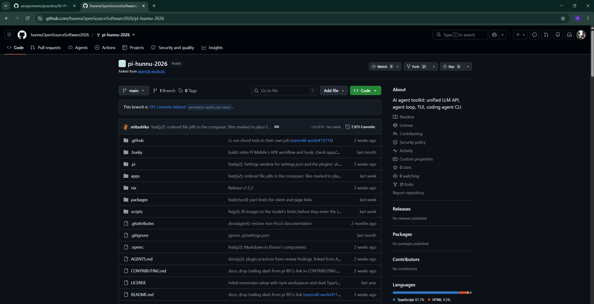
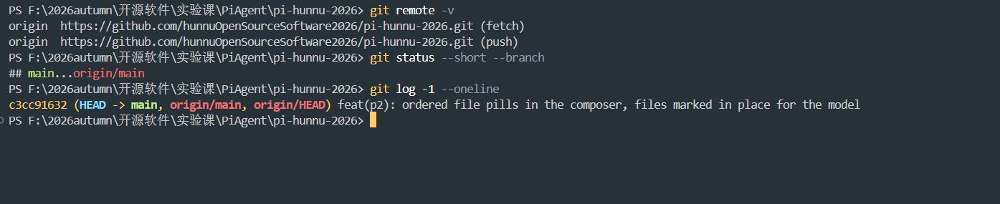
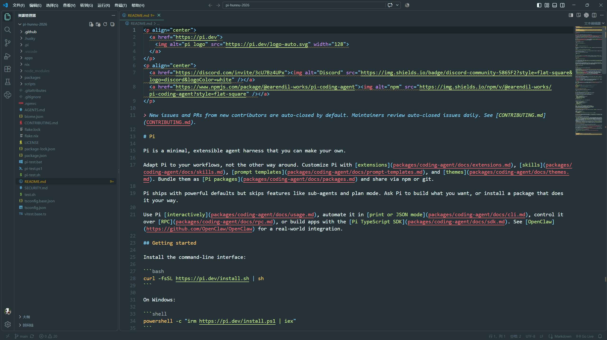
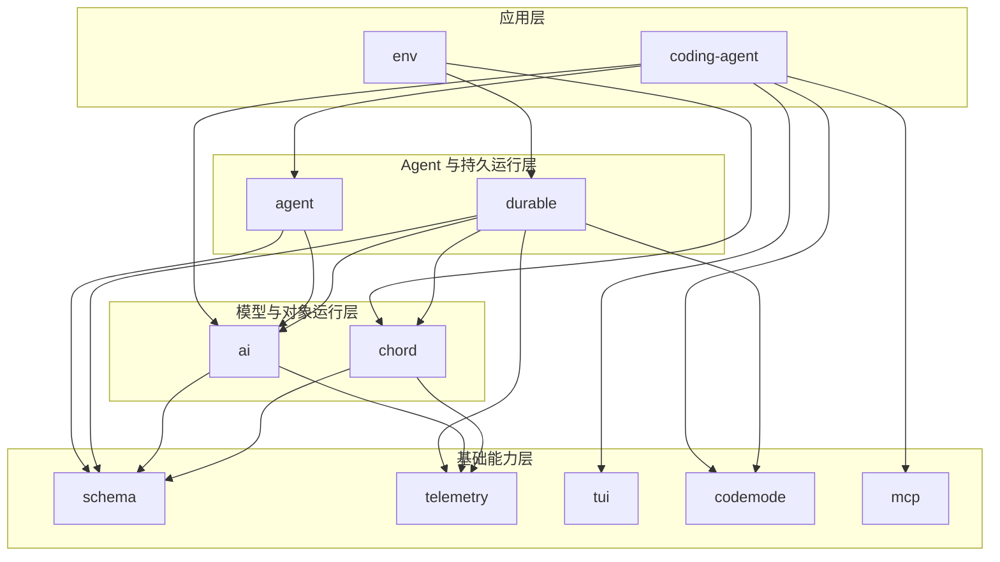

# PiAgent 模块构建与依赖分析报告

本地仓库当前配置的 `origin` 地址为：

```text
https://github.com/hunnuOpenSourceSoftware2026/pi-hunnu-2026.git
```

本地源码目录是 `F:\2026autumn\开源软件\实验课\PiAgent\pi-hunnu-2026`。查看仓库信息时，本地分支为 `main`，跟踪 `origin/main`，当前提交为 `c3cc91632`。

### 组织仓库页面

下图展示了课程组织的仓库页面和项目文件列表。



### 克隆后的仓库信息

下图展示了在本地执行 `git remote -v`、`git status --short --branch` 和 `git log -1 --oneline` 的结果。



### 本地源码目录

下图展示了在编辑器中打开的源码目录，其中 `packages` 文件夹包含本次分析的模块。



## 一、分析范围与方法

项目根目录为 `F:\2026autumn\开源软件\实验课\PiAgent\pi-hunnu-2026`。这次主要分析 `coding-agent`、`agent` 和 `ai`，也查看了题目中的其他模块。我先阅读各模块的 README 和 `src` 源码，了解它们的功能，再根据 `package.json` 中的 `dependencies` 整理直接依赖。这里也包括源码中只用于类型的导入；通过其他模块间接依赖的模块不算直接依赖。

在我的项目版本中，题目列出的 11 个文件夹都在 `packages/` 下，根目录的 `build` 脚本也包含了它们。仓库中还有 `packages/evals`、`apps/p2`、`apps/p2-mac`、`apps/p3` 等目录，不过它们没有出现在根目录的 `build` 脚本中，因此这次没有画入依赖图。项目配置的工作区除了这些包和应用，还包含一些示例，所以工作区范围比根构建脚本涉及的范围更大。

## 二、模块功能、构建和依赖

表中的路径都从项目根目录开始计算。表里的 `tsc` 指 `tsc -p tsconfig.build.json`：它根据模块自身的构建配置和根目录的 `tsconfig.base.json`，把 `src` 中的 TypeScript 编译到 `dist` 目录，生成 JavaScript、类型声明和映射文件。依赖一列只填写项目内部模块；写“无”的模块仍可能使用第三方包。

| 子文件夹 | 代码主要实现的功能 | 本模块 build 执行的工作和产物 | 直接内部依赖 | 依据文件或代码位置 |
| --- | --- | --- | --- | --- |
| `telemetry` | 提供记录程序运行信息的接口，例如跨度、计数器和指标，也提供内存版本和不执行记录的空实现。 | 执行 `tsc`，输出到 `dist/`。 | 无 | `packages/telemetry/README.md`；`src/metrics.ts`、`src/memory.ts`；本模块 `package.json`、`tsconfig.build.json`。 |
| `schema` | 用于创建和验证 JSON Schema，支持 2020-12 和 Draft 7 等版本，并将校验规则编译成函数。 | 执行 `tsc`，输出到 `dist/`。 | 无 | `packages/schema/README.md`；`src/builders.ts`、`src/compiler.ts`；本模块构建配置。 |
| `chord` | 提供跨进程运行对象的能力，包含对象接口、文档、存储、通信和插件等功能。 | 执行 `tsc`，输出到 `dist/`。 | `schema`、`telemetry` | `packages/chord/README.md`；`src/contracts/`、`src/store/`、`src/link/`；本模块 `package.json`。 |
| `tui` | 提供终端界面组件和键盘输入处理，通过只更新变化的内容来减少界面闪烁。 | 执行 `tsc`，输出到 `dist/`；平台原生组件由单独的 `build:native:*` 脚本构建。 | 无 | `packages/tui/README.md`；`src/tui-main-screen.ts`、`src/components/`；本模块 `package.json`。 |
| `codemode` | 在 QuickJS 沙箱中执行模型编写的 JavaScript，并通过注入接口调用工具。 | `tsc`，输出到 `dist/`；构建配置还显式引入环境声明文件。 | 无 | `packages/codemode/README.md`；`src/runtime/`、`src/wasm.ts`；`tsconfig.build.json`。 |
| `mcp` | 实现独立的 MCP 客户端，提供协议请求处理及标准输入输出、HTTP 等传输方式。 | `tsc`，输出到 `dist/`。 | 无 | `packages/mcp/README.md`；`src/client.ts`、`src/transports/`；本模块 `package.json`。 |
| `ai` | 封装不同供应商的模型调用，还处理模型目录、身份认证、流式响应和工具参数等。 | 先运行 `generate-models`，获取上游目录并生成模型数据和代码；然后运行 `build:offline`，检查数据、执行 `tsc`，再将供应商数据复制到 `dist/providers/data/`。 | `schema`、`telemetry` | `packages/ai/README.md`、`catalog/README.md`；`src/models.ts`、`src/telemetry.ts`；本模块 `package.json`。 |
| `durable` | 管理可持久化的会话、模型轮次、工具调用和任务；进程中断后可从存储恢复。 | `tsc`，输出到 `dist/`；配置中的路径映射引用 `chord` 和 `ai` 的构建声明。 | `chord`、`ai`、`codemode`、`schema`、`telemetry` | `packages/durable/README.md`；`src/session/`、`src/storage/`、`src/tools/`；本模块 `package.json`、`tsconfig.build.json`。 |
| `env` | 为 Durable 提供远程执行环境，通过 SSH 连接远端守护程序，执行文件操作和命令。 | 普通 `build` 仅运行 `tsc` 并输出到 `dist/`；Rust 守护程序由单独的 `build:daemon` 调用 Cargo。 | `chord`、`durable` | `packages/env/README.md`；`src/remote-env.ts`、`src/ssh.ts`、`daemon/`；本模块 `package.json`。 |
| `agent` | 实现通用 Agent，保存对话状态，并负责模型调用、工具执行和事件输出。 | 执行 `tsc`，输出到 `dist/`；构建配置把 `pi-ai` 指向其 `dist` 中的声明文件。 | `ai`、`schema` | `packages/agent/README.md`；`src/agent.ts`、`src/agent-loop.ts`；本模块 `package.json`、`tsconfig.build.json`。 |
| `coding-agent` | 提供编码 Agent 命令行程序，组合模型、Agent、终端界面和工具，支持会话及扩展。 | 先编译到 `dist/`、设置 CLI 和 RPC 入口可执行权限并复制主题、图片、HTML 导出资源；再用 esbuild 生成 `dist/bundle/`，包含入口、分块及延迟加载文件。独立二进制由另一个 `build:binary` 脚本生成。 | `agent`、`ai`、`codemode`、`mcp`、`tui` | `packages/coding-agent/README.md`；`src/main.ts`、`src/modes/`、`src/extensions/mcp/runtime.ts`；本模块 `package.json`；`scripts/build-coding-agent-bundle.mjs`。 |

## 三、模块层级与直接依赖图

图中的箭头都从使用方指向被依赖方。实线表示模块在 `package.json` 的 `dependencies` 中直接声明的内部依赖。这些模块之间没有声明开发依赖或可选依赖，所以图中使用同一种线条。第三方包没有画在图中。

可编辑图源：[模块依赖图.mmd](模块依赖图.mmd)。



我主要根据各模块的功能和依赖方向划分层级。基础层提供数据校验、运行信息记录、终端界面、沙箱和协议等能力；模型与对象运行层使用部分基础能力；Agent 与持久运行层进一步组织模型调用、工具和状态；应用层包含编码程序及远程执行环境适配。图中也画出了跨层的直接依赖。

`env` 主要负责适配远程执行环境，本身并不是一个完整的独立应用。这里把它放在最上层，是因为它使用了 `durable` 和 `chord`。它与同层的 `coding-agent` 没有直接依赖关系。

## 四、构建配置和执行过程

1. 在根目录执行 `npm run build` 时，npm 会读取根目录 `package.json` 中的 `scripts.build`，按脚本中的顺序进入 11 个模块，分别执行它们的构建命令。命令之间用 `&&` 连接，前面的命令失败后，后面的命令就不会继续执行。根脚本没有直接通过根目录 `tsconfig.json` 编译所有模块。
2. 在某个模块目录执行 `npm run build` 时，npm 会先读取该模块 `package.json` 中的构建脚本。多数模块使用 TypeScript 编译器，并读取本模块的 `tsconfig.build.json`；这个文件又继承了根目录的 `tsconfig.base.json`。基础配置规定了编译目标、类型检查和声明文件等选项，模块配置主要规定源码和输出目录。部分模块还用 `paths` 指向其他模块 `dist` 中的声明文件，`ai` 则单独设置了 NodeNext 模块解析方式。
3. 除编译外，`ai` 还要生成和检查模型数据，`coding-agent` 还要复制资源并打包。根目录的 `build:offline` 在构建 `ai` 时使用它的离线构建脚本，但需要提前准备好模型数据，并通过检查。普通 `build` 不会自动完成测试、全项目 `check`、平台原生组件构建和 Rust 守护程序构建。

## 五、构建顺序与依赖关系

根脚本当前的构建顺序是 `telemetry → schema → chord → tui → codemode → mcp → ai → durable → env → agent → coding-agent`。从依赖图可以看出，被依赖的模块都排在使用它的模块前面。例如，`durable/tsconfig.build.json` 引用了 `chord/dist` 和 `ai/dist` 中的类型声明，所以先构建 `chord` 和 `ai`，才能准备好这些文件。`coding-agent` 的打包脚本也会检查 `ai/dist` 等输入文件是否存在。

构建顺序相邻的模块不一定存在依赖。例如 `tui` 排在 `codemode` 前面，但它们的 `package.json` 都没有声明依赖对方。有直接依赖的模块也不一定相邻，例如 `coding-agent` 直接依赖 `tui`，两者在构建顺序中隔了好几个模块。互不依赖的模块可以采用不同的先后顺序，当前顺序由根目录脚本写定。

## 六、一条依赖路径

选择 `coding-agent → agent → ai → schema`：

1. `coding-agent` 提供面向用户的编码命令行和会话、工具等功能，并调用 `agent` 的能力组织交互。
2. `agent` 管理对话状态与工具执行循环，调用 `ai` 提供的模型接口。`packages/agent/src/agent.ts` 和 `agent-loop.ts` 均引用 `pi-ai`。
3. `ai` 负责对接不同模型供应商，并直接使用 `schema` 的能力。`schema` 负责创建和验证 JSON Schema，上层可以用它描述和检查结构化数据。

这条路径中的每一条箭头都表示直接依赖。另外，`coding-agent` 也直接依赖 `ai`，所以依赖图中单独画出了这条边。

## 七、回答问题
1.根目录与子模块中的 npm run build 分别读取什么配置、执行什么工作？
答：在根目录执行 npm run build 时，npm 读取根目录 package.json 中的 scripts.build。这个脚本按指定顺序进入各个子模块，依次执行它们的构建命令。命令之间使用 && 连接，如果某个模块构建失败，后面的命令就不会继续执行。
在子模块目录执行 npm run build 时，npm 读取该模块 package.json 中的 scripts.build。多数模块会运行 tsc -p tsconfig.build.json：TypeScript 编译器读取模块的 tsconfig.build.json，同时继承根目录的 tsconfig.base.json，然后将 src 中的源码编译到 dist 目录，生成 JavaScript、类型声明和映射文件。

2.构建顺序和模块依赖有什么关系？相邻构建的模块是否一定互相依赖？
答：项目通常需要先构建被依赖的模块，再构建使用它的模块。这样，后面的模块就可以读取前面模块生成的代码或类型声明文件。
比如，`durable` 的构建配置引用了 chord/dist 和 ai/dist 中的类型声明，所以根构建脚本先构建 chord 和 ai，再构建 durable。
相邻构建的模块不一定互相依赖。例如，根脚本中 tui 排在 codemode 前面，但两者没有在各自的 package.json 中声明依赖对方。直接依赖的模块也不一定相邻，例如 coding-agent 直接依赖 tui，两者在构建顺序中隔了多个模块。

3.选择一条涉及至少三个模块的依赖路径，说明这些模块如何分工。
答：选择依赖路径：coding-agent → agent → ai → schema。
- coding-agent 提供用户使用的编码 Agent 命令行，负责组织会话、界面和工具等功能。
- agent 管理对话状态，组织模型调用和工具执行的循环。
- ai 封装不同模型供应商的接口，为上层提供模型调用能力。
- schema 提供 JSON Schema 的创建和验证能力，帮助上层描述和检查结构化数据。
